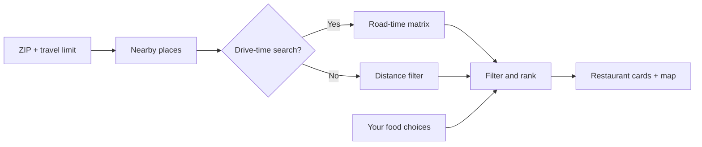

<p align="center">
  
</p>

<p align="center">
  <strong>The answer to “I don’t know. What do you want to eat?”</strong><br>
  A food-first restaurant finder that turns a few gut reactions into nearby places worth trying.
</p>

<p align="center">
  <a href="https://crave-restaurant-finder.vercel.app"><strong>🍽 Open Crave</strong></a>
  &nbsp;·&nbsp;
  <a href="#get-running-in-a-minute">Run locally</a>
  &nbsp;·&nbsp;
  <a href="#connect-restaurant-search">Connect Geoapify</a>
  &nbsp;·&nbsp;
  <a href="https://vercel.com/ai-learning-center/crave-restaurant-finder">Vercel dashboard</a>
</p>

<p align="center">
  
  
  
  
</p>

> **Bring your appetite—and a Geoapify key.** Restaurant search requires a key from your own Geoapify account. Save it once per browser through **Connect restaurant search**. The interface and food quiz can be explored before connecting. Live provider speed and results have not yet been verified with an account key.


*Actual deployed interface before connecting a Geoapify key; no restaurant results are simulated.*

## Dinner, without the debate

You know the feeling: everyone’s hungry, nobody has a plan, and another endless list of restaurants isn’t helping.

Crave starts with the food. Say **Yum**, **Hmm, maybe**, or **Nah** to a few dishes. Enter your ZIP code, set how far you’ll go, and explore restaurants on a map, ordered around your cuisine preferences.

No mystery match percentages. No invented reviews. Just your cravings, reported cuisine data, and actual nearby places.

## What’s on the menu?

| Feature | What it does |
| --- | --- |
| **A 24-dish taste quiz** | Rate burgers, ramen, tacos, pasta, and more. Stop whenever you have a feel for what sounds good. |
| **Editable food choices** | Revisit every answer in one list. Undo an edit, clear a rating, or reset your profile. |
| **ZIP + travel limits** | Search by straight-line distance or estimated road driving time from the ZIP center. |
| **An interactive map** | Numbered pins match the cards. Explore details and open driving directions. |
| **Food-themed progress** | A simmering pot, elapsed time, and actual search stages keep you informed. |
| **Source-backed Local badges** | Selected businesses earn a badge only when published evidence supports local ownership. |
| **Useful ways to narrow it down** | Filter by cuisine or explicitly listed dietary options; sort by match, distance, or drive time. |
| **Save it for later** | Heart favorites in your browser, or let “Choose for me” pick from your current matches. |

## From “what’s for dinner?” to “let’s go”

**Example: you’re in ZIP 85083 and can drive 15 minutes.**

1. **Connect restaurant search.** Complete the one-time Geoapify setup below.
2. **Choose your area.** Enter `85083`, select **Drive time · minutes**, and choose **15 minutes**.
3. **Find restaurants.** The cooking indicator shows the search stage. You can rate dishes while it runs.
4. **Follow your appetite.** Burger → **Yum**. Sushi → **Nah**. Pasta → **Hmm, maybe**.
5. **Browse your matches.** Preferred cuisines move up the list. Map numbers correspond to restaurant cards.
6. **Check the details.** Review the website, listed hours, ownership evidence, and directions. Confirm current menus with the restaurant.
7. **Change your mind anytime.** Open **Your food choices** and edit a rating. Loaded results reorder immediately without another restaurant lookup.

You can also rate dishes first and select **Show my matches**. All 24 ratings are optional.

## How matching works

Crave uses a small, explainable cuisine-ranking system:

- **Yum** adds a strong preference (`+3`).
- **Hmm, maybe** adds a mild preference (`+1`).
- **Nah** lowers priority (`−2`); it does not hide the restaurant.
- Specific food preferences take priority over broader cuisine families. Liking ramen does not cancel a dislike of sushi.
- Unknown cuisine stays unknown. A restaurant name or a food photograph is not evidence of a dish on the menu.



## Get running in a minute

**Requires Node.js 22 or newer.** There is no npm install step and no application build step. Leaflet and food imagery are bundled locally; the application uses native JavaScript modules.

```bash
git clone https://github.com/VincentAZ/crave-restaurant-finder.git
cd crave-restaurant-finder
npm run dev
```

Open **http://localhost:4387**.

```bash
npm test       # Node's built-in test runner
npm run check  # JavaScript syntax checks
```

## Connect restaurant search

1. Create a free account at [Geoapify MyProjects](https://myprojects.geoapify.com/) and create a project named **Crave**.
2. Open **API Keys**. Restrict the browser key to the origins you use:
   - Production: `https://crave-restaurant-finder.vercel.app`
   - Local development: `http://localhost:4387`
   - Your own deployment: its exact origin.
3. Open Crave → **Connect restaurant search**.
4. Paste the key and select **Save key & search**.

The key is saved only in that browser and sent directly to Geoapify. It is not committed to this repository or embedded in the deployment. Each browser needs its own setup. **Restaurant search settings** lets you replace or remove the key; **Data & privacy → Clear my saved data** removes it too.

Geoapify’s free plan has a daily credit allowance. Drive-time searches use more credits than distance searches because they calculate a route to each candidate. Check [Geoapify pricing](https://www.geoapify.com/pricing/) for current limits. Crave does not configure paid upgrades.

## Deploy your own

This is a static app. `vercel.json` tells Vercel to serve `dist/` and run the checks before deployment.

1. Fork this repository and import it into Vercel.
2. Use **Other** as the framework preset and the repository root as the root directory.
3. Keep the included configuration: output directory `dist`, build command `npm run check && npm test`, and no install command.
4. Deploy, allow the resulting origin in your Geoapify key restrictions, and connect the key in your browser.

**Project links:** [Live app](https://crave-restaurant-finder.vercel.app) · [Repository](https://github.com/VincentAZ/crave-restaurant-finder) · [Vercel dashboard](https://vercel.com/ai-learning-center/crave-restaurant-finder).

The Vercel dashboard requires project access. This repository supports a personal bring-your-own-key experience; a public consumer service would need centrally managed provider access and quota controls.

## Data you can understand

| Data | Source |
| --- | --- |
| ZIP centers | Zippopotam.us |
| Restaurants and cuisine information | Geoapify Places, using OpenStreetMap data |
| Road driving estimates | Geoapify Route Matrix |
| Interactive map | Leaflet + OpenStreetMap tiles |
| Local ownership evidence | A small reviewed register with links to published sources |
| Food illustrations | Locally bundled Unsplash photographs; illustrative, not restaurant menu photos |

**Local means evidence, not a guess.** Initial coverage includes selected Phoenix-area Someburros, Sardella’s, and Osteria Mia locations. Unknown ownership is labeled **Local ownership unverified**. Missing chain tags never count as proof. Evidence expires after 180 days.

### Practical limits

- Distances start at an approximate ZIP center, not your exact address.
- Driving times exclude live traffic. Unavailable routes do not receive made-up estimates.
- Searches consider up to 200 nearby places. Drive-time mode checks up to 120 candidates selected by taste and proximity. Results are not exhaustive.
- Dietary filters require affirmative source tags. Always confirm dietary needs directly.
- The last successful restaurant query is cached for 15 minutes. ZIP lookup has a six-second timeout, provider requests have eight-second deadlines, and the whole search stops after 15 seconds. A deadline limits waiting; it does not guarantee successful results.
- Provider coverage, availability, menus, and opening hours can change.

## Privacy, in plain English

Food ratings, favorites, search settings, the cached restaurant response, and your Geoapify key stay in browser storage. ZIP codes and coordinates are sent to the providers needed for search and mapping. Fonts load from Google Fonts. There are no analytics.

Switching browsers or domains starts a separate profile. Clearing browser data removes saved preferences and credentials.

## Inside the kitchen

```text
dist/
  index.html       Page structure and user walkthrough
  styles.css       Responsive layout, motion, and visual design
  app.js           Quiz, map, dialogs, search, and favorites
  core.js          Food catalog, cuisine scoring, filters, distances
  api.js           Bounded HTTP requests and ZIP lookup
  geoapify.js      Places, routing, key storage, and result caching
  search.js        Search coordination and cancellation
  ratings.js       Editable choices and undo history
  ownership.js     Reviewed local-ownership evidence
  progress.js      Search-stage presentation
  assets/          Leaflet, its license, and food photography
tests/             Behavior and provider-contract tests
docs/              README artwork
server.mjs         Local static server
vercel.json        Static deployment configuration
```

## Verification

The current suite contains **43 passing tests** covering cuisine ranking, conflicting preferences, travel boundaries, missing routes, cancellation, timeouts, ownership evidence, editable ratings, cache expiry, provider errors, and a simulated ZIP → places → route-matrix flow.

The production Vercel page was also checked in Chrome: the map loaded, rating a dish worked, the editable list reflected the choice, and Undo restored the previous answer. No console errors were observed during those checks.

Provider tests use explicit fixtures. They do **not** prove live Geoapify availability or latency. Successful live restaurant searches and complete browser verification still require a configured account key. No fixture restaurants are shipped as app results.

## Contributing

Found a confusing interaction, an incorrect ownership claim, or a reproducible search issue? [Open an issue](https://github.com/VincentAZ/crave-restaurant-finder/issues) with the ZIP, travel mode, expected behavior, and error text. **Never include API keys.**

For changes, run `npm test` and `npm run check`. Keep cuisine and ownership claims tied to actual data, preserve unknown values, and document any new provider requirements.

## Credits

[Leaflet](https://leafletjs.com/) is distributed under its included BSD-2-Clause license. Map and restaurant source data include [OpenStreetMap contributors](https://www.openstreetmap.org/copyright) under ODbL. Food photography comes from [Unsplash](https://unsplash.com/license). Geoapify and other services have their own usage terms.

This repository does not yet declare a license for the application source. Public visibility alone does not grant additional reuse rights.
