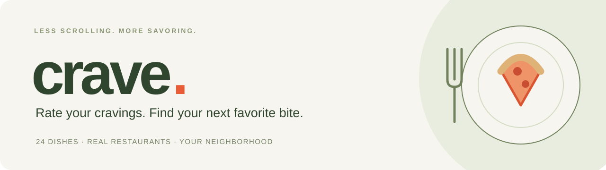
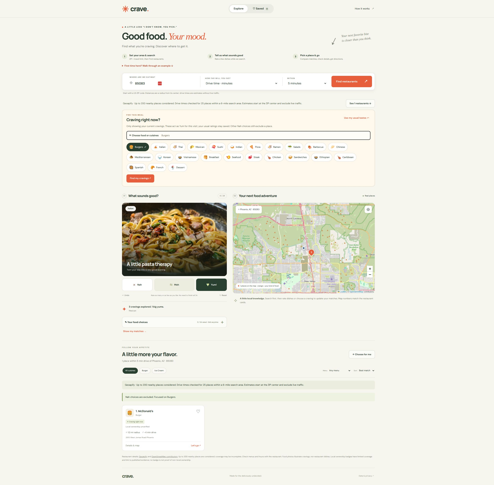
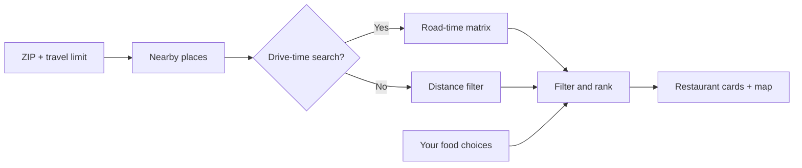

<p align="center">
  
</p>

<p align="center">
  <strong>The answer to “I don’t know. What do you want to eat?”</strong><br>
  A food-first restaurant finder that turns a few gut reactions into nearby places worth trying.
</p>

<p align="center">
  <a href="https://crave-restaurant-finder.vercel.app"><strong>🍽 Open Crave</strong></a>
  &nbsp;·&nbsp;
  <a href="#get-running-in-a-minute">Run locally</a>
  &nbsp;·&nbsp;
  <a href="#server-setup-for-the-owner">Server setup</a>
  &nbsp;·&nbsp;
  <a href="https://vercel.com/ai-learning-center/crave-restaurant-finder">Vercel dashboard</a>
</p>

<p align="center">
  
  
  
  
</p>

> **Just bring your appetite.** Visitors enter a ZIP code and search—no API key, account, or browser setup. The app owner configures Geoapify once on Vercel. Incognito sessions work the same way; only locally saved food choices disappear when a private session ends.



## Dinner, without the debate

You know the feeling: everyone’s hungry, nobody has a plan, and another endless list of restaurants isn’t helping.

Crave starts with the food. Say **Yum**, **Meh**, or **Nah** to a few dishes. Enter your ZIP code, set how far you’ll go, and explore restaurants on a map, ordered around your cuisine preferences.

No mystery match percentages. No invented reviews. Just your cravings, reported cuisine data, and actual nearby places.

## What’s on the menu?

| Feature | What it does |
| --- | --- |
| **A 24-dish taste quiz** | Rate burgers, ramen, tacos, pasta, and more. Stop whenever you have a feel for what sounds good. |
| **Editable food choices** | Revisit every answer in one list. Yum is a first choice, Meh is a backup, and Nah excludes matching places. Undo an edit, clear a rating, or reset your profile. |
| **Craving right now** | Pick one or more foods or cuisines for this meal. Temporarily treat them as Yum and focus results on them without changing saved ratings. |
| **ZIP + travel limits** | Search by straight-line distance or estimated road driving time from the ZIP center. |
| **An interactive map** | Numbered pins match the cards. Explore details and open driving directions. |
| **Food-themed progress** | A simmering pot, elapsed time, and actual search stages keep you informed. |
| **Source-backed Local badges** | Selected businesses earn a badge only when published evidence supports local ownership. |
| **Useful ways to narrow it down** | Filter by cuisine or explicitly listed dietary options; sort by match, distance, or drive time. |
| **Save it for later** | Heart favorites in your browser, or let “Choose for me” pick from your current matches. |

## From “what’s for dinner?” to “let’s go”

**Example: you’re in ZIP 85083 and can drive 15 minutes.**

1. **Open Crave.** There is no visitor setup or API key prompt.
2. **Choose your area.** Enter `85083`, select **Drive time · minutes**, and choose **15 minutes**.
3. **Find restaurants.** The cooking indicator shows the search stage. You can rate dishes while it runs.
4. **Follow your appetite.** Burger → **Yum**. Sushi → **Nah**. Pasta → **Meh**.
5. **Browse your matches.** Nah matches are excluded. Yum matches come first; Meh backups appear if any Yum choice has no match. Map numbers correspond to restaurant cards.
6. **Check the details.** Review the website, listed hours, ownership evidence, and directions. Confirm current menus with the restaurant.
7. **Change your mind anytime.** Open **Your food choices** and edit a saved rating, or choose **Craving right now** for this meal. Loaded results update immediately. **Find my cravings** searches if needed, including refreshing drive-time candidates after a taste change. **Use my usual tastes** clears the temporary choices.

You can also rate dishes first and select **Show my matches**. All 24 ratings are optional.

## How matching works

Crave applies your choices to reported cuisine tags:

- **Nah** excludes the entire restaurant when any matching food is rated Nah, even if it also serves a Yum. This applies to cards, map pins, saved results, sorting, and surprise picks.
- **Yum** is the first choice. **Meh** appears only when at least one Yum food has no eligible restaurant after travel, dietary, cuisine, and saved-place filters. The results explain which Yum choices are missing. If no Yum is set, Meh options can be shown.
- Yum matches always precede Meh backups. Distance or driving-time sorting orders restaurants within those groups.
- **Craving right now** focuses results on the selected foods and temporarily treats them as Yum, overriding their own saved Meh or Nah. Other Nah ratings still exclude a place. Current cravings clear on reload or **Use my usual tastes**; saved ratings are unchanged. Missing current cravings do not silently broaden the search to unrelated food.
- Specific reported tags distinguish related foods: sushi + Japanese is evaluated as sushi, while ramen + Japanese is evaluated as ramen. A place explicitly tagged with both sushi and ramen is excluded if either is Nah. A broad Japanese-only or Italian-only tag uses the applicable ratings conservatively: a matching Nah wins.
- With positive ratings or a current craving, only matching rated cuisines are included. Before positive ratings are set, other cuisines and unknown cuisines remain explorable after Nah exclusions. Cuisine tags cannot establish a dish's presence on today's menu.

Driving searches exclude Nah candidates and prioritize current cravings before the 120-route limit. Meh candidates are retained until road times are known, because a Yum may be outside the travel limit. After changing choices, loaded results update immediately; the interface prompts another search when driving candidates need refreshing.



## Get running in a minute

**Requires Node.js 22 or newer.** There is no npm install step and no application build step. Leaflet and food imagery are bundled locally; the application uses native JavaScript modules.

```bash
git clone https://github.com/VincentAZ/crave-restaurant-finder.git
cd crave-restaurant-finder
npm run dev
```

Open **http://localhost:4387**. For live restaurant search locally, copy `.env.example` to `.env.local`, fill in your development Geoapify key, and restart the server. Node loads this ignored file automatically.

```bash
npm test       # Node's built-in test runner
npm run check  # JavaScript syntax checks
```

## Server setup (for the owner)

1. Create a Geoapify project at [MyProjects](https://myprojects.geoapify.com/) if you do not already have one.
2. Use a key that permits server-to-server requests. A key restricted to browser origins/referrers may reject server requests; use a separate server key if needed.
3. In [Vercel environment variables](https://vercel.com/ai-learning-center/crave-restaurant-finder/settings/environment-variables), add `GEOAPIFY_API_KEY` as a **Production Secret** (Sensitive).
4. Deploy after saving the variable. Vercel environment changes apply to new deployments.

The key is read only by the server functions. It never appears in the public JavaScript, browser storage, API responses, or repository. Visitors do not need a Geoapify account. Any key stored by an older browser-based release is removed locally on page load; it is never uploaded.

For preview deployments, configure a separate Preview key if live provider tests are needed. Keep `.env.local` ignored and never put secrets under `dist/`.

Geoapify usage is shared across visitors and subject to the owner's plan. Place lookups return at most 200 entries; route requests have at most 120 destinations within 35 miles. Successful place responses can be cached at Vercel's CDN for 15 minutes. A per-instance throttle provides a basic safeguard, not a global quota guarantee; provider quotas remain the shared usage limit. See [Geoapify pricing](https://www.geoapify.com/pricing/).

## Deploy your own

The frontend is static; two Vercel Functions handle restaurant and driving-time requests. `vercel.json` serves `dist/` and runs checks before deployment. Vercel discovers the functions in `api/` automatically.

1. Fork this repository and import it into Vercel.
2. Use **Other** as the framework preset and the repository root as the root directory.
3. Keep the included configuration: output directory `dist`, build command `npm run check && npm test`, and no install command.
4. Add `GEOAPIFY_API_KEY` as a server Secret, then deploy. Visitors can search immediately without setup.

**Project links:** [Live app](https://crave-restaurant-finder.vercel.app) · [Repository](https://github.com/VincentAZ/crave-restaurant-finder) · [Vercel dashboard](https://vercel.com/ai-learning-center/crave-restaurant-finder).

The Vercel dashboard requires project access. The provider credential is managed centrally by the owner; it is not supplied by visitors.

## Data you can understand

| Data | Source |
| --- | --- |
| ZIP centers | Zippopotam.us |
| Restaurants and cuisine information | Geoapify Places, using OpenStreetMap data |
| Road driving estimates | Geoapify Route Matrix |
| Interactive map | Leaflet + OpenStreetMap tiles |
| Local ownership evidence | A small reviewed register with links to published sources |
| Food illustrations | Locally bundled Unsplash photographs; illustrative, not restaurant menu photos |

**Local means evidence, not a guess.** Initial coverage includes selected Phoenix-area Someburros, Sardella’s, and Osteria Mia locations. Unknown ownership is labeled **Local ownership unverified**. Missing chain tags never count as proof. Evidence expires after 180 days.

### Practical limits

- Distances start at an approximate ZIP center, not your exact address.
- Driving times exclude live traffic. Unavailable routes do not receive made-up estimates.
- Searches consider up to 200 nearby places. Drive-time mode checks up to 120 candidates selected by taste and proximity. Results are not exhaustive.
- Dietary filters require affirmative source tags. Always confirm dietary needs directly.
- The last successful restaurant query is cached for 15 minutes. ZIP lookup has a six-second timeout, upstream provider requests have eight-second deadlines, and the whole search stops after 15 seconds. A deadline limits waiting; it does not guarantee successful results.
- Provider coverage, availability, menus, and opening hours can change.

## Privacy, in plain English

Food ratings, favorites, search settings, and the cached restaurant response stay in browser storage. Current cravings stay only in page memory and clear on reload. The API key stays on the server. ZIP codes go to Zippopotam.us; search and route coordinates pass through Crave’s server to Geoapify. Map coordinates go to OpenStreetMap. Fonts load from Google Fonts. There are no analytics.

Switching browsers or domains starts a separate profile. Clearing browser data removes saved preferences, but does not disconnect restaurant search.

## Inside the kitchen

```text
dist/
  index.html       Page structure and user walkthrough
  styles.css       Responsive layout, motion, and visual design
  app.js           Quiz, map, dialogs, search, and favorites
  core.js          Food catalog, cuisine scoring, filters, distances
  api.js           Bounded HTTP requests and ZIP lookup
  geoapify.js      Same-origin API client, data normalization, result caching
  search.js        Search coordination and cancellation
  ratings.js       Editable choices and undo history
  ownership.js     Reviewed local-ownership evidence
  progress.js      Search-stage presentation
  assets/          Leaflet, its license, and food photography
api/               Vercel restaurant and route endpoints
lib/               Server validation, provider authentication, safe errors
tests/             Behavior and provider-contract tests
docs/              README artwork
server.mjs         Local frontend and API server
vercel.json        Static deployment configuration
```

## Verification

The current suite contains **60 passing tests** covering Nah vetoes, conditional Meh fallback, temporary cravings, conflicting cuisine preferences, travel boundaries, missing routes, cancellation, timeouts, ownership evidence, editable ratings, cache expiry, provider errors, and a simulated ZIP → places → route-matrix flow.

The updated craving flow was checked in Chrome using the local frontend and a temporary preview proxy to the existing public production APIs (no local provider key). ZIP **85083** verified that missing Thai Yum matches enabled burger Meh backups, available Mexican Yum matches hid those backups, and a current burger craving returned **1 place within a five-minute drive** while the saved burger rating stayed Meh. Restoring usual tastes refreshed driving candidates and returned **2 Yum matches**. Reloading cleared the temporary craving and retained the saved rating. No browser console errors were observed. These are point-in-time checks; the preview proxy is not part of the application.

The production Vercel page was also checked in Chrome: the map loaded, rating a dish worked, the editable list reflected the choice, and Undo restored the previous answer. No console errors were observed during those checks.

Live production search was verified on October 28, 2026 with the server-managed Geoapify key: ZIP **85083** returned **106 places within five miles** and **7 places within a five-minute drive**. Chrome displayed the map, restaurant cards, estimated drive times, and a Local badge without asking for a key; no console errors were observed. A separate request without cookies or credentials also succeeded. These results are a point-in-time check, not an availability or latency guarantee.

Automated provider tests use explicit fixtures and additionally verify that fresh sessions need no credentials, provider errors do not leak keys, and oversized requests are rejected before spending provider credits. No fixture restaurants are shipped as app results.

## Contributing

Found a confusing interaction, an incorrect ownership claim, or a reproducible search issue? [Open an issue](https://github.com/VincentAZ/crave-restaurant-finder/issues) with the ZIP, travel mode, expected behavior, and error text. **Never include API keys.**

For changes, run `npm test` and `npm run check`. Keep cuisine and ownership claims tied to actual data, preserve unknown values, and document any new provider requirements.

## Credits

[Leaflet](https://leafletjs.com/) is distributed under its included BSD-2-Clause license. Map and restaurant source data include [OpenStreetMap contributors](https://www.openstreetmap.org/copyright) under ODbL. Food photography comes from [Unsplash](https://unsplash.com/license). Geoapify and other services have their own usage terms.

This repository does not yet declare a license for the application source. Public visibility alone does not grant additional reuse rights.
